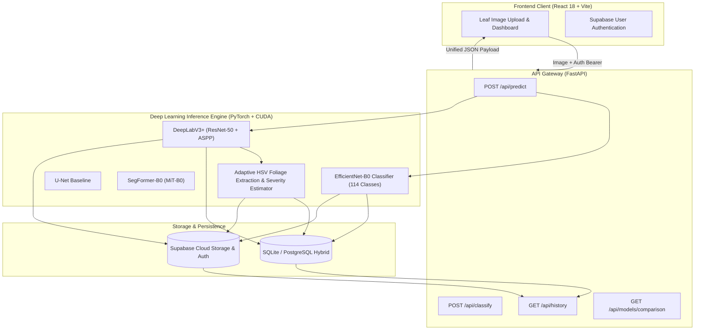

# Food Security Through Intelligent Crop Health Monitoring
## Integrated Plant Pathology Classification, Deep Lesion Segmentation & Quantitative Severity Assessment

[](https://www.python.org/)
[](https://pytorch.org/)
[](https://developer.nvidia.com/cuda-toolkit)
[](https://fastapi.tiangolo.com/)
[](https://reactjs.org/)
[](https://vitejs.dev/)
[](https://docs.pytest.org/)

An end-to-end, deep learning application designed to safeguard agricultural food security. Given a single field photograph of an affected crop leaf, the system simultaneously executes:
1. **Botanical Pathology Classification:** Fine-tuned **EfficientNet-B0** predicts the specific plant disease, host botanical taxon, and a ranked Top-3 differential diagnosis with uncertainty warnings across **114 foliar disease categories** and **35 host crop species**.
2. **Pixel-Level Lesion Segmentation:** Evaluates three distinct segmentation paradigms on the **PlantSeg** benchmark:
   - **DeepLabV3+ (Production Champion):** ImageNet-pretrained ResNet-50 backbone with Atrous Spatial Pyramid Pooling (ASPP).
   - **U-Net (CNN Baseline):** Custom 4-stage convolutional encoder-decoder trained from scratch.
   - **SegFormer-B0 (Transformer Baseline):** Custom MiT-B0 hierarchical patch transformer with multi-scale all-MLP decoder trained from scratch.
3. **Quantitative Disease Severity Estimation:** Measures the exact percentage of affected leaf surface area $(A_{\text{disease}} / A_{\text{leaf}}) \times 100$ and categorizes severity into standardized agronomic tiers (Healthy, Mild, Moderate, Severe).
4. **Cloud-Connected Dashboard:** Enterprise FastAPI backend with Supabase Authentication, row-level security, cloud storage, and an interactive React monitoring dashboard.

---

## 1. System Architecture



---

## 2. PlantSeg Dataset & Taxonomy Breakdown

The models are trained and benchmarked on the comprehensive **PlantSeg** agricultural dataset:

* **Total Samples:** **11,458 paired images and masks** across official splits:
  - **Training Split:** 7,916 images & masks
  - **Validation Split:** 1,247 images & masks
  - **Test Split (Official):** 2,295 images & masks
  - **Strictly Leakage-Free Test Split:** 2,165 images (excluding 130 cross-split duplicates identified via MD5 byte-hash audit)
* **Pathology Coverage:** **114 distinct disease classes** (e.g., *Tomato Early Blight*, *Apple Scab*, *Wheat Stripe Rust*, *Corn Smut*, *Bell Pepper Blossom End Rot*, *Soybean Frogeye Leaf Spot*).
* **Host Plant Coverage:** **35 unique botanical crop taxa** (Wheat, Tomato, Soybean, Corn, Apple, Banana, Citrus, Grape, Cucumber, Bell Pepper, Potato, Coffee, etc.).
* **Mask Quality:** High-resolution categorical lesion annotations with corrected binary ground-truth masks.

---

## 3. Empirical Model Benchmarks

### A. Disease Classification Benchmark (EfficientNet-B0)
Evaluated on the held-out clean test split ($N = 2,182$):

| Metric | Performance Score |
| :--- | :---: |
| **Top-1 Accuracy** | **71.13%** |
| **Top-3 Accuracy** | **89.46%** |
| **Macro Precision** | **0.6412** |
| **Macro Recall** | **0.6029** |
| **Macro F1-Score** | **0.6034** |
| **Weighted F1-Score** | **0.6981** |
| **Bell Pepper Blossom End Rot Recall** | **100.0%** (21 / 21) |
| **Inference Latency (RTX 4050)** | **1.85 ms / image** |
| **Parameters / Checkpoint Size** | 4,153,582 (4.15M) / 48.01 MB |
| **Checkpoint Path** | `models/checkpoints/efficientnet_b0_best.pth` |

---

### B. Full-Dataset Segmentation Benchmark (PlantSeg Val Split, $256 \times 256$, BS=8)
All three models were trained under identical conditions on the complete PlantSeg training split (7,916 images) using AdamW, combined BCE + Soft Dice loss, FP16 Automatic Mixed Precision (AMP), and gradient clipping ($1.0$):

| Architecture | Paradigm | Best Epoch | Val Macro Dice | Val Macro IoU | Val Loss | Peak VRAM | Latency (BS=1) | Throughput (BS=8) | Checkpoint Size |
| :--- | :---: | :---: | :---: | :---: | :---: | :---: | :---: | :---: | :---: |
| **DeepLabV3+ (Champion)** | ResNet-50 Pretrained + ASPP | **19** / 20 | **0.7057** | **0.5894** | **0.2948** | ~872 MB | 5.22 ms | 239.2 FPS | 462.24 MB |
| **U-Net (CNN Baseline)** | Custom 4-Stage CNN from Scratch | **23** / 25 | **0.6434** | **0.5190** | **0.3419** | ~689 MB | **3.22 ms** | 226.6 FPS | 49.52 MB |
| **SegFormer-B0 (Transformer)** | Custom MiT-B0 from Scratch | **29** / 30 | **0.6096** | **0.4879** | **0.3774** | **~572 MB** | 5.48 ms | **347.2 FPS** | **42.68 MB** |

#### Scientific Findings:
1. **Pretrained Transfer Learning Superiority:** DeepLabV3+ with an ImageNet-pretrained ResNet-50 backbone achieved superior segmentation accuracy (**0.7057 Dice**, $+6.23\%$ over U-Net, $+9.61\%$ over SegFormer-B0).
2. **Inductive Bias in Scratch Training:** U-Net outperformed SegFormer-B0 ($0.6434$ vs. $0.6096$ Dice) when trained strictly from scratch without external pretraining, demonstrating the value of convolutional inductive bias for spatial localization on medium-scale datasets.
3. **Transformer Throughput:** SegFormer-B0 demonstrated the highest batch throughput (**347.2 FPS**) and lowest GPU VRAM allocation (**572 MB**).

---

## 4. Hardware and Runtime Environment

* **GPU:** NVIDIA GeForce RTX 4050 Laptop GPU (6 GB VRAM)
* **CUDA Version:** 13.0
* **PyTorch Version:** 2.12.0+cu130
* **Python Runtime:** Python 3.13
* **Mixed Precision:** FP16 Automatic Mixed Precision (`torch.amp.autocast`)
* **Multiprocessing:** Windows-compatible DataLoader with `num_workers = 2`, `pin_memory = True`, and `persistent_workers = True`

---

## 5. Quickstart Guide

### Prerequisites
* Python 3.10+ (Tested up to Python 3.13)
* Node.js 18+ and npm
* Git & Git LFS (for large model checkpoints)
* NVIDIA GPU with CUDA support (optional, CPU fallback supported)

### Installation

1. **Clone the repository and install Git LFS:**
   ```bash
   git clone https://github.com/BIT-SIZE/Major-project.git
   cd Major-project
   git lfs install
   git lfs pull
   ```

2. **Install Python dependencies:**
   ```bash
   pip install -r requirements.txt
   ```

3. **Install Frontend dependencies:**
   ```bash
   cd frontend
   npm install
   cd ..
   ```

4. **Environment Setup:**
   Copy `.env.example` to `.env` in both root and frontend:
   ```bash
   copy .env.example .env
   copy frontend\.env.example frontend\.env
   ```

---

## 6. Running the Application

### Start the FastAPI Backend:
```bash
python -m uvicorn backend.app.main:app --host 127.0.0.1 --port 8000 --reload
```
* Interactive Swagger Docs: `http://127.0.0.1:8000/docs`
* API Health Check: `http://127.0.0.1:8000/api/health`

### Start the React Frontend Dashboard:
```bash
cd frontend
npm run dev
```
* Dashboard URL: `http://127.0.0.1:5173`

### Run Automated Backend Test Suite (43 Tests):
```bash
python -m pytest backend/tests/ -v
```
*(Covers API endpoints, authentication, prediction repository, severity estimation, dataset sampling, and Supabase integration).*

---

## 7. Model Training & Evaluation CLI

### DeepLabV3+ Training (Differential Learning Rates):
```bash
python scripts/train_deeplabv3plus.py --epochs 20 --batch-size 8 --lr 0.0005 --backbone-lr 0.0001
```

### U-Net Baseline Training:
```bash
python scripts/train_unet.py --epochs 25 --batch-size 8 --lr 0.0003
```

### SegFormer-B0 Training:
```bash
python scripts/train_segformer.py --epochs 30 --batch-size 8 --lr 0.0001
```

### Resume Training from Checkpoint:
All scripts support seamless resumption with full state restoration:
```bash
python scripts/train_deeplabv3plus.py --resume models/checkpoints/deeplabv3plus_last.pth
```

---

## 8. API Reference

### 1. Unified Diagnosis & Segmentation (`POST /api/predict`)
Performs pathology classification, lesion segmentation, and quantitative severity estimation in a single inference call:
```bash
curl -X POST "http://127.0.0.1:8000/api/predict" \
     -F "file=@sample_leaf.jpg" \
     -F "model_name=deeplabv3plus"
```

**Response Payload:**
```json
{
  "prediction_id": "9b1d7d54-44b2-4d22-8395-5db4f30ad067",
  "status": "success",
  "classification": {
    "status": "success",
    "host_plant": "bell pepper",
    "predicted_disease": "bell pepper blossom end rot",
    "top_predictions": [
      { "disease": "bell pepper blossom end rot", "score": 0.964 },
      { "disease": "bell pepper bacterial spot", "score": 0.021 },
      { "disease": "tomato blossom end rot", "score": 0.009 }
    ],
    "model_name": "EfficientNet-B0",
    "uncertainty_warning": null
  },
  "segmentation": {
    "status": "success",
    "model_name": "DeepLabV3+",
    "mask_url": "/static/predictions/..._mask.png",
    "overlay_url": "/static/predictions/..._overlay.jpg"
  },
  "severity": {
    "available": true,
    "percentage": 8.42,
    "category": "Moderate",
    "health_indicator": 91.58,
    "reason": "Calculated using adaptive HSV foliage mask denominator."
  },
  "inference": {
    "classification_time_ms": 1.85,
    "segmentation_time_ms": 5.22,
    "total_time_ms": 7.07
  }
}
```

### 2. Standalone Disease Classification (`POST /api/classify`)
Fast classification pipeline (~1.85 ms) bypassing segmentation mask generation.

### 3. Model Inventory & Metrics (`GET /api/models`, `GET /api/models/comparison`)
Returns model architecture parameters, checkpoint sizes, and empirical validation scores.

### 4. Prediction History (`GET /api/history`)
Paginated query interface with filtering by host plant, disease pathology, or severity tier.

---

## 9. Project Directory Structure

```
plantsegv2/
├── backend/
│   ├── app/
│   │   ├── api/routes/          # Predictions, Analytics, History endpoints
│   │   ├── core/                # Security, Config, JWT tokens
│   │   ├── db/                  # SQLite models, repository, Supabase client
│   │   ├── ml/                  # Severity estimator, inference wrappers
│   │   └── main.py              # FastAPI application entrypoint
│   └── tests/                   # 43 automated unit & integration tests
├── frontend/
│   ├── src/                     # React components, dashboard, Supabase services
│   └── package.json
├── ml/
│   ├── configs/                 # YAML configurations (DeepLabV3+, U-Net, SegFormer)
│   ├── dataset/                 # Dataset loader, transforms, stratified sampler
│   ├── evaluation/              # Metrics tracker, model comparison suite
│   ├── models/                  # Architecture definitions (DeepLab, U-Net, SegFormer)
│   └── training/                # Standardized trainer, BCE+Dice losses, checkpoint manager
├── models/
│   └── checkpoints/             # Best model weights (*_best.pth tracked via Git LFS)
├── reports/
│   └── training/                # Training loss/Dice curves and history logs
├── scripts/                     # Standalone training and evaluation CLIs
├── Metadatav2.csv               # Dataset manifest (7,916 train, 1,247 val, 2,295 test)
├── requirements.txt
└── README.md
```

---

## 10. Clinical & Agronomic Advisory

1. **Pathology Scope:** This system is trained on 114 specific plant disease pathologies across 35 host species. Non-crop photographs or unsupported diseases will trigger automated low-confidence warnings when top-1 prediction probability is below 35%.
2. **Decision Support:** Predictions provided by this system are designed for diagnostic screening and monitoring. Critical chemical or biological interventions should be validated by certified agronomists.
