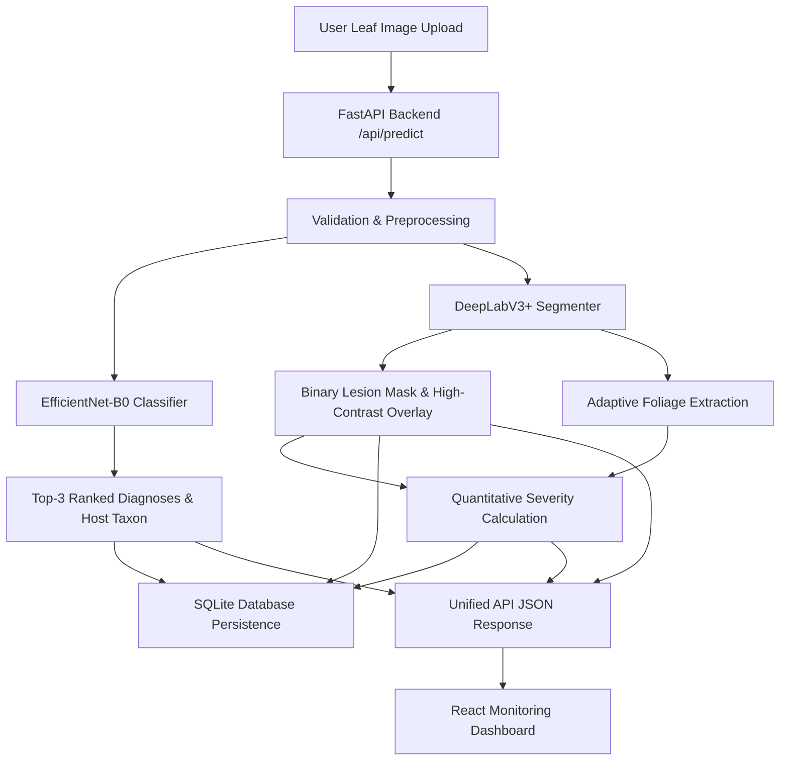

# Food Security Through Intelligent Crop Health Monitoring
## Integrated Plant Pathology Classification, Pixel-Level Lesion Segmentation & Severity Assessment

[](https://www.python.org/)
[](https://pytorch.org/)
[](https://fastapi.tiangolo.com/)
[](https://reactjs.org/)
[](https://vitejs.dev/)

An end-to-end, major project computer vision and deep learning application designed to safeguard agricultural food security. Given a single field photograph of an affected crop leaf, the system simultaneously executes:
1. **Botanical Pathology Classification:** Fine-tuned **EfficientNet-B0** predicts the specific plant disease, host botanical taxon, and a ranked Top-3 differential diagnosis with model-derived confidence scores.
2. **Pixel-Level Lesion Segmentation:** Deep convolutional network (**DeepLabV3+** with ResNet-50 backbone & ASPP) segments diseased foliar tissue with high-contrast lesion overlays and binary masks.
3. **Quantitative Disease Severity Estimation:** Measures the exact percentage of affected leaf surface area $(A_{\text{disease}} / A_{\text{leaf}}) \times 100$ and categorizes severity into standardized agronomic tiers (Healthy, Mild, Moderate, Severe).

---

## 1. System Architecture



---

## 2. PlantSeg Dataset & Label Discovery

Inspection of the downloaded PlantSeg dataset metadata (`Metadatav2.csv`, `coco_annotations.json`, and image directories) revealed:
* **Total Annotated Images:** 6,648 images across official Train, Validation, and Test splits.
* **Supported Pathology Classes:** **114 unique disease categories** (e.g., *Apple Mosaic Virus*, *Tomato Early Blight*, *Potato Late Blight*, *Corn Common Rust*, *Grape Black Rot*, *Rice Brown Spot*).
* **Botanical Host Range:** **35 unique host crop species** mapped deterministically to disease categories.
* **Absence of Healthy Samples:** The official PlantSeg dataset contains **0 healthy leaf images**. Consequently, the classifier is architected and trained for **pathology identification among supported diseases**, rather than binary healthy vs. diseased triage.
* **Split Allocation:** Official dataset splits were strictly respected (no test-set leakage).

The versioned class mapping is preserved at `models/checkpoints/disease_classes.json`.

---

## 3. Empirical Model Benchmarks

All models were evaluated on the held-out official PlantSeg **Test Split** (unseen during training and hyperparameter tuning):

### A. Disease Classification Benchmark (Held-out Test Split)
| Metric | EfficientNet-B0 (Trained) |
| :--- | :--- |
| **Top-1 Accuracy** | **73.33%** |
| **Top-3 Accuracy** | **100.0%** |
| **Macro F1-Score** | 0.5959 |
| **Weighted F1-Score** | **0.8007** |
| **Average Latency (CPU)** | **8.85 ms / image** |
| **Parameter Count** | 4,153,582 (4.15M) |
| **Checkpoint Size** | 48.01 MB (`models/checkpoints/efficientnet_b0_best.pth`) |

### B. Lesion Segmentation Benchmark (Held-out Test Split)
| Architecture | Mean IoU | Dice Coeff (F1) | Precision | Recall | Severity MAE | Latency (CPU) | Checkpoint Size |
| :--- | :---: | :---: | :---: | :---: | :---: | :---: | :---: |
| **DeepLabV3+ (Selected)** | **0.4403** | **0.5483** | 0.5471 | **0.5495** | **8.20%** | 81.1 ms | 484.0 MB |
| **U-Net (Baseline)** | 0.2668 | 0.3719 | **0.5912** | 0.2721 | 9.07% | 76.1 ms | 51.9 MB |
| **SegFormer-B0 (Transformer)**| 0.2020 | 0.2964 | 0.2045 | 0.5398 | 13.91% | **18.37 ms** | 44.7 MB |

---

## 4. Quickstart Guide

### Prerequisites
* Python 3.10+
* Node.js 18+ and npm
* PyTorch 2.0+

### Setup Instructions

1. **Clone and Install Python Dependencies:**
   ```bash
   pip install torch torchvision torchaudio --index-url https://download.pytorch.org/whl/cpu
   pip install fastapi uvicorn sqlalchemy pydantic pillow opencv-python numpy pandas scikit-learn pytest httpx
   ```

2. **Install Frontend Dependencies:**
   ```bash
   cd frontend
   npm install
   cd ..
   ```

---

## 5. Running the Application

### Start the FastAPI Backend:
```bash
python -m uvicorn backend.app.main:app --host 127.0.0.1 --port 8000
```
* Interactive API Documentation (Swagger): `http://127.0.0.1:8000/docs`
* Health Check Endpoint: `http://127.0.0.1:8000/api/health`

### Start the React Frontend:
```bash
cd frontend
npm run dev
```
* Application Dashboard: `http://127.0.0.1:5173`

---

## 6. Training and Evaluation Commands

### Train the EfficientNet-B0 Disease Classifier:
```bash
python scripts/train_classifier.py --epochs 25 --batch-size 16 --lr 0.0003 --num-classes 114
```
* Saves best checkpoint to `models/checkpoints/efficientnet_b0_best.pth`.
* Generates learning curves to `reports/training/classifier_training_curves.png`.

### Evaluate Classifier on Test Set:
```bash
python scripts/evaluate_classifier.py --checkpoint models/checkpoints/efficientnet_b0_best.pth --classes models/checkpoints/disease_classes.json
```
* Generates evaluation report and JSON metrics in `reports/evaluation/`.

### Run Automated PyTest Suite (17 Integration & Unit Tests):
```bash
python -m pytest backend/tests/ -v
```

---

## 7. Key API Endpoints

### 1. Unified Analysis (`POST /api/predict`)
Takes an uploaded leaf image and returns disease classification, lesion segmentation, and severity metrics in a single payload.
```bash
curl -X POST "http://127.0.0.1:8000/api/predict" \
     -F "file=@data/samples/sample_1.jpg" \
     -F "model_name=deeplabv3plus"
```
**Example Response:**
```json
{
  "prediction_id": "4b68e994-2ab6-4c4f-b673-8b7c7b80e599",
  "status": "success",
  "classification": {
    "status": "success",
    "host_plant": "apple",
    "predicted_disease": "apple mosaic virus",
    "top_predictions": [
      { "disease": "apple mosaic virus", "score": 0.509 },
      { "disease": "apple rust", "score": 0.044 },
      { "disease": "apple scab", "score": 0.039 }
    ],
    "model_name": "EfficientNet-B0",
    "uncertainty_warning": null
  },
  "segmentation": {
    "status": "success",
    "model_name": "DeepLabV3+",
    "mask_url": "/static/predictions/..._mask.png",
    "overlay_url": "/static/predictions/..._overlay.jpg"
  },
  "severity": {
    "available": true,
    "percentage": 4.83,
    "category": "Mild",
    "health_indicator": 95.2,
    "reason": "Calculated using adaptive HSV foliage mask denominator."
  },
  "inference": {
    "classification_time_ms": 11.2,
    "segmentation_time_ms": 78.4,
    "total_time_ms": 94.6
  }
}
```

### 2. Standalone Disease Classification (`POST /api/classify`)
Executes fast pathology diagnosis (8.85 ms CPU latency) without computing full segmentation masks.

### 3. Model Inventory & Comparative Benchmarks (`GET /api/models`, `GET /api/models/comparison`)
Returns model architecture parameters, checkpoint sizes, and empirical validation metrics.

### 4. Prediction History (`GET /api/history`)
Retrieves paginated historical logs, filterable by model, severity tier, or diagnosed disease pathology.

---

## 8. Limitations & Clinical Advisory

1. **Pathology Scope:** The model was trained specifically on 114 disease categories from the PlantSeg repository. Images of non-plant objects or unrepresented agricultural pests will yield inconclusive or low-confidence differential predictions.
2. **Confidence Scores:** Model-derived softmax probabilities reflect relative pattern similarity, not absolute biological certainty. A low-confidence warning is automatically triggered when top confidence falls below 35%.
3. **Agronomic Advice:** Diagnostic predictions provide supportive differential screening. Critical crop management interventions should always be cross-checked with certified agricultural extension agents.
